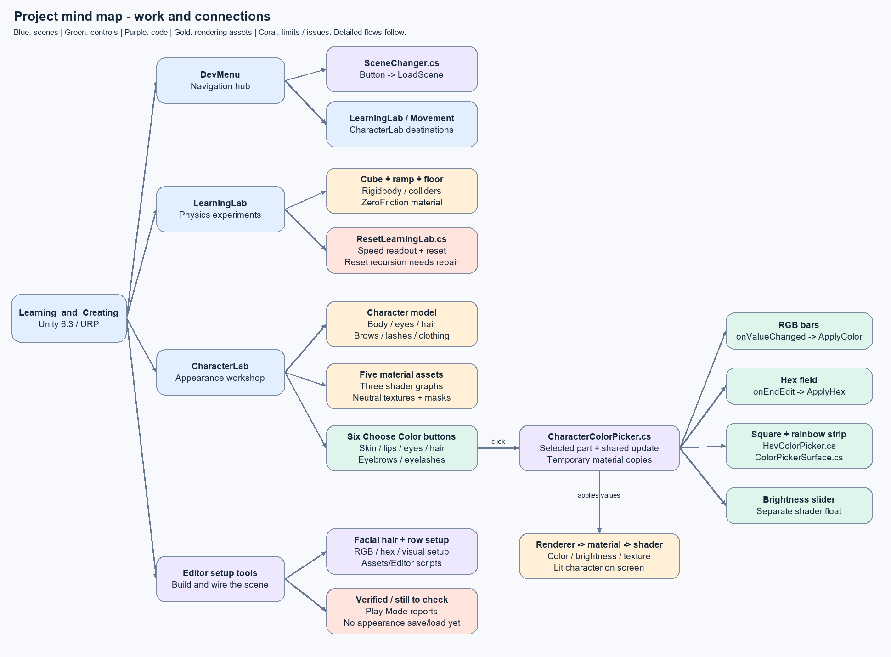
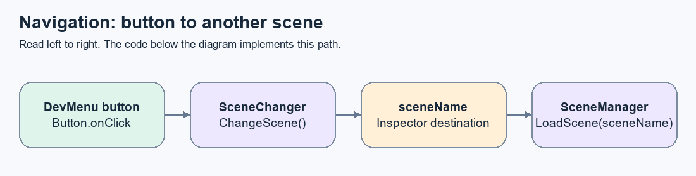
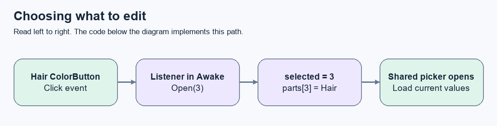
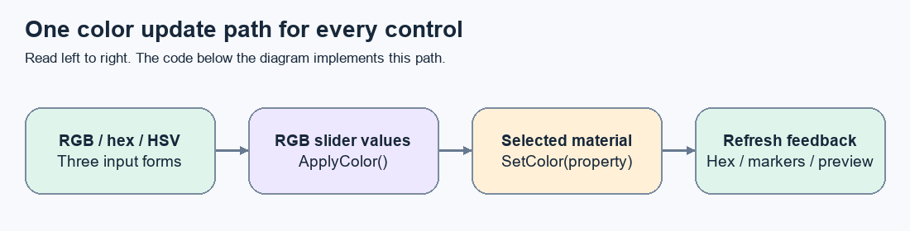
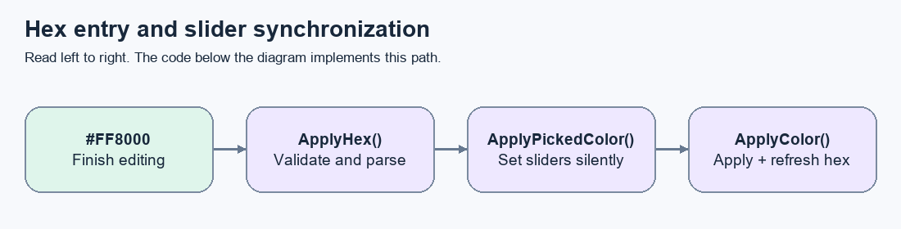
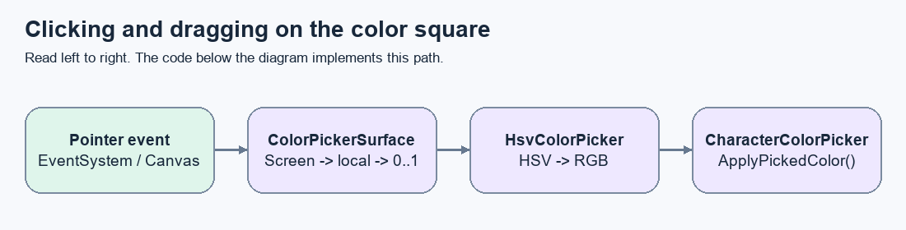
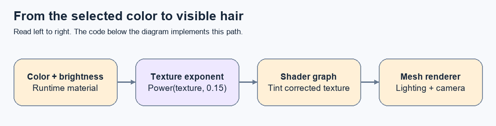
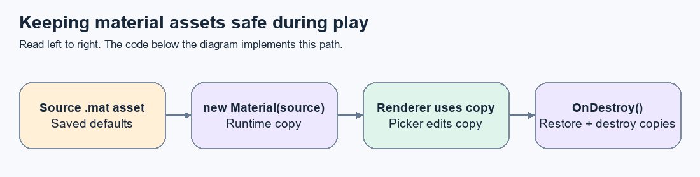
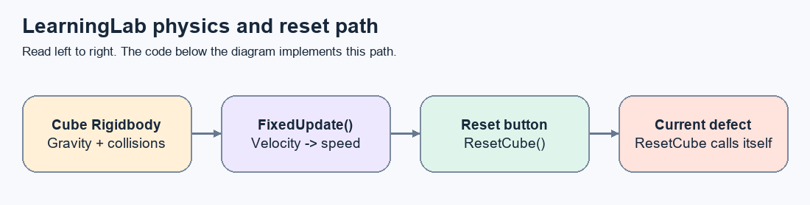

# Learning_and_Creating — project guide and dependency maps

**Snapshot: 15 October 2026 · Unity 6000.3.24f1 · Universal Render Pipeline (URP)**

This guide explains what exists, which objects depend on which scripts, and how a user action reaches the character on screen. It is written for someone learning programming and for a programmer continuing the project.

**Scope:** `H:\ChatGPT - IT\Unity-Project\Learning_and_Creating`. The older `H:\ChatGPT_Bible_Game` prototype is a separate project, not part of this architecture.

The source and serialized scene files were inspected for this snapshot. Code excerpts below are copied from the current scripts unless explicitly called an excerpt. Verification reports are historical evidence from the recent implementation, not a fresh full-game regression run. This documentation task makes no gameplay changes.

## Contents

- [Overall map](#1-one-big-mind-map) and [work status](#2-work-completed-and-current-limits)
- [DevMenu navigation](#3-devmenu--button--another-scene)
- [CharacterLab hierarchy](#4-characterlab-where-the-components-live)
- [Buttons](#5-choose-color-button--selected-part--shared-controls), [RGB](#6-rgb-bars--material--all-feedback-controls), [hex](#7-hex--rgb-bars-and-rgb-bars--hex), and [visual picker](#8-swatch-square--hue-strip--rgb--hex--material)
- [Rendering and shaders](#9-selected-color--material--shader--model), [brightness](#10-brightness-a-separate-material-setting), and [material lifetime](#11-material-ownership-and-lifetime)
- [Physics/reset](#12-learninglab-physics-speed-and-the-reset-issue) and [editor tools](#13-editor-tools-versus-runtime-scripts)
- [Worked example](#14-a-complete-worked-example), [verification](#15-evidence-checks-and-next-work), and [glossary](#16-vocabulary-and-source-index)

## How to read this guide

Start with the big map. Then follow a smaller bubble diagram, read the code beneath it, and read the explanation. The diagrams are real PNG pictures with scalable SVG versions. Keep the `diagrams` folder beside this Markdown file when moving it.

- **Contains / hierarchy:** one object is physically under another in the Unity Hierarchy.
- **Reference:** a component stores a link to another object, such as a Button or Material.
- **Event / call:** something happens, and code invokes a function.
- **Data flow:** a value, such as a color, moves between components.

These are different relationships. The menu does not contain the shader. A script connects a menu control to a material, and the material uses a shader.

## 1. One big mind map



[Open scalable SVG](diagrams/01-project-map.svg)

DevMenu is the development navigation hub. It opens separate scenes where experiments and features are built. CharacterLab is one of those scenes; its customization menu is a different menu inside that scene.

## 2. Work completed and current limits

| Area | Work present | Current evidence or limit |
|---|---|---|
| Navigation | DevMenu buttons target LearningLab, Movement and CharacterLab; lab return buttons target DevMenu | Source and scene references inspected; default build list issue below |
| Reusable UI | `Assets/Prefabs/Scene-oppening-button.prefab` | Actual filename contains this spelling |
| Physics learning | Cube, floor, ramp, Rigidbody, colliders, ZeroFriction, reset and speed script | Reset script currently has a recursion defect |
| Movement | Scene with floor, camera, UI and return navigation | No custom movement-controller script found in Assets/Scripts; do not describe it as completed player movement |
| Character foundation | Imported male character and separate appearance meshes | Rig/animation functionality is outside the verified scope |
| Skin and lips | Neutral base, lip mask, independent tint and brightness | Shared skin material; separate shader properties |
| Eyes | Eye texture and iris mask, independent iris tint | No separate brightness property |
| Hair | Neutral texture, tint, brightness, alpha clipping; corrected hair-fit asset; texture exponent correction | User accepted the corrected hair appearance |
| Brows and lashes | Separate materials and neutral textures using the hair shader | User accepted appearance; eyebrows cutoff 0.25 |
| In-game menu | Six buttons, one shared picker, preview and colored buttons | Recent automated Play Mode report passed all six targets |
| RGB and hex | Bidirectional synchronization, validation and current-part recall | Automated checks passed; user manually accepted one hex case |
| Visual picker | Hue strip, saturation/value square, pointer handlers and selection markers | Automated sync/pointer checks passed; final visual layout review still pending |
| Persistence | Appearance is temporary during play | Save/load across sessions has not been implemented |

Recent Git checkpoints establish the earlier milestones: `5b42399` navigation/prefab, `f0bd918` physics, `b42f64d` reset work, `4383af4` friction/speed, `df71bb2` character foundation, `212225d` skin/lips/hair/facial hair. The later menu and picker work is present in the working tree; do not assume it is committed.

## 3. DevMenu → button → another scene



[Open scalable SVG](diagrams/02-navigation.svg)

Source: [SceneChanger.cs](../../Assets/Scripts/SceneChanger.cs). The scene-name value is assigned in the Inspector; it is not hardcoded inside `ChangeScene()`.

```csharp
using UnityEngine;
using UnityEngine.SceneManagement;

public class SceneChanger : MonoBehaviour
{
    [SerializeField] private string sceneName;

    public void ChangeScene()
    {
        SceneManager.LoadScene(sceneName);
    }
}
```

`[SerializeField]` lets Unity save and show the private `sceneName` field. Clicking the navigation button invokes its Inspector-configured `ChangeScene` callback. `SceneManager.LoadScene` loads that destination; these labs are separate scenes, not panels created inside DevMenu.

| DevMenu object | Destination |
|---|---|
| OpenLearningLabButton | LearningLab |
| BtnMovementScene | Movement |
| BtnCharacterLabScene | CharacterLab |

Lab return buttons use the same script with `sceneName = DevMenu`.

**Known issue:** `ProjectSettings/EditorBuildSettings.asset` currently enables DevMenu, LearningLab and Movement, but not CharacterLab. The navigation button references CharacterLab, so the default scene-loading setup is incomplete. Confirm the active build profile and add CharacterLab to its scene list before relying on that route in a build. Opening CharacterLab directly in the editor does not prove this navigation route works.

## 4. CharacterLab: where the components live

This is a simplified hierarchy; repeated slider internals and imported model details are omitted.

```text
CharacterLab
├── Main Camera / Directional Light
├── EventSystem + InputSystemUIInputModule
├── Canvas + GraphicRaycaster + CharacterColorPicker
│   ├── DevMenu button + SceneChanger
│   ├── CharacterCustomizationPanel
│   │   ├── Title
│   │   └── Skin / Lips / Eyes / Hair / Eyebrows / Eyelashes ColorRow
│   │       ├── Label (TextMeshPro)
│   │       └── ColorButton (Image + Button)
│   │           └── Text (TMP)
│   └── ColorPickerPanel + HsvColorPicker
│       ├── PickerTitle / ColorPreview
│       ├── ColorSquare + RawImage + ColorPickerSurface
│       │   └── ShadeMarker
│       ├── HueStrip + RawImage + ColorPickerSurface
│       │   └── HueMarker
│       ├── HexLabel / HexInput / HexError
│       ├── RedSlider / GreenSlider / BlueSlider
│       ├── BrightnessLabel / BrightnessSlider
│       └── DoneButton
└── MaleCharacter_Base
    └── Imported body and accessory renderers
        ├── Body
        ├── Eyes (low-poly mesh)
        ├── Hair (short02)
        ├── Eyebrows (eyebrow001)
        ├── Eyelashes (eyelashes01)
        └── Clothing
```

The Canvas displays UI. Its GraphicRaycaster finds UI under the pointer. The EventSystem and input module deliver clicks/drags to controls. A RectTransform describes each UI rectangle, its anchors, size and pivot. TextMeshPro displays labels; it does not decide which character part is edited.

**Important ownership detail:** the six buttons do not each have a `CharacterColorPicker` script. One controller on the Canvas stores references to all six Button components. The visual picker is on ColorPickerPanel, while the two pointer-handler components are on the square and strip.

## 5. Choose Color button → selected part → shared controls



[Open scalable SVG](diagrams/03-button.svg)

Source: [CharacterColorPicker.cs](../../Assets/Scripts/CharacterColorPicker.cs). Each `Part` entry groups a button, source material and shader-property names. `parts[3]` is Hair because arrays begin at zero. Here is the actual registration loop from `Awake()`:

```csharp
for (int i = 0; i < parts.Length; i++)
{
    int index = i;
    parts[i].button.onClick.AddListener(() => Open(index));
    UpdateButton(parts[i]);
}
```

`onClick.AddListener` subscribes a function to a click. `() => Open(index)` is a small anonymous function (a lambda). The local `index` gives each listener its own captured part number. These callbacks are registered during play, unlike the navigation button’s persistent Inspector callback.

Clicking a button chooses a target; it does not immediately recolor it. The following method loads that target’s current settings into the shared picker:

```csharp
public void Open(int index)
{
    selected = index;
    var part = parts[index];
    var color = part.instance.GetColor(part.colorProperty);
    red.SetValueWithoutNotify(color.r);
    green.SetValueWithoutNotify(color.g);
    blue.SetValueWithoutNotify(color.b);
    preview.color = new Color(color.r, color.g, color.b, 1);
    RefreshHex(color);
    pickerTitle.text = part.title + " Color";
    bool supported = !string.IsNullOrEmpty(part.brightnessProperty) && part.instance.HasProperty(part.brightnessProperty);
    brightness.interactable = supported;
    brightness.SetValueWithoutNotify(supported ? part.instance.GetFloat(part.brightnessProperty) : 1);
    brightnessLabel.text = supported ? "Brightness " + brightness.value.ToString("0.00") : "Brightness — unavailable for eyes";
    pickerPanel.SetActive(true);
}
```

`selected` remembers which part subsequent changes affect. `SetActive(true)` shows the picker. Reading the runtime material restores that part’s latest values when switching between parts.

| Index / target | Material asset | Color property | Brightness property |
|---|---|---|---|
| 0 Skin | CharacterSkin | `_Skin_Color` | `_Skin_Brightness` |
| 1 Lips | CharacterSkin | `_Lips_Color` | `_Lip_Brightness` |
| 2 Eyes | CharacterEyes | `_Iris_Color` | None |
| 3 Hair | CharacterHair | `_Hair_Color` | `_Hair_Brightness` |
| 4 Eyebrows | CharacterEyebrows | `_Hair_Color` | `_Hair_Brightness` |
| 5 Eyelashes | CharacterEyelashes | `_Hair_Color` | `_Hair_Brightness` |

Skin and lips share a material but use different properties. Hair, eyebrows and eyelashes share a shader but have different material assets, allowing independent values.

## 6. RGB bars → material → all feedback controls



[Open scalable SVG](diagrams/04-color-sync.svg)

The three RGB sliders emit change events. Their values are floating-point numbers from 0 to 1. Registration excerpt from `Awake()`:

```csharp
red.onValueChanged.AddListener(_ => ApplyColor());
green.onValueChanged.AddListener(_ => ApplyColor());
blue.onValueChanged.AddListener(_ => ApplyColor());
```

The `_` means the event’s supplied value is unused: `ApplyColor()` reads all three current values instead.

```csharp
void ApplyColor()
{
    if (selected < 0) return;
    var part = parts[selected];
    var color = new Color(red.value, green.value, blue.value, 1);
    part.instance.SetColor(part.colorProperty, color);
    preview.color = color;
    UpdateButton(part);
    RefreshHex(color);
}
```

`new Color(r, g, b, 1)` builds an RGB color with full opacity. `SetColor` sends it to the selected runtime material’s named shader property. `preview.color` updates the preview image. `UpdateButton` colors the target button and chooses black or white text for readability.

The color’s runtime state lives in the material instance. RGB controls are the common input path used when applying changes; there is no separate saved appearance data model yet.

Feedback is refreshed here. Despite its name, `RefreshHex()` now also updates the visual picker:

```csharp
void RefreshHex(Color color)
{
    if (visualPicker) visualPicker.SetColorWithoutNotify(color);
    if (hexInput) hexInput.SetTextWithoutNotify("#" + ColorUtility.ToHtmlStringRGB(color));
    if (hexError) hexError.text = "";
}
```

## 7. Hex → RGB bars, and RGB bars → hex



[Open scalable SVG](diagrams/05-hex.svg)

Registration excerpt:

```csharp
if (hexInput) hexInput.onEndEdit.AddListener(ApplyHex);
```

The field commits when editing ends, such as Enter or losing focus. It does not apply every incomplete character while you type.

```csharp
public void ApplyHex(string value)
{
    if (selected < 0) return;
    string digits = (value ?? "").Trim();
    if (digits.StartsWith("#")) digits = digits.Substring(1);
    bool valid = digits.Length == 6;
    foreach (char c in digits)
        valid &= (c >= '0' && c <= '9') || (c >= 'a' && c <= 'f') || (c >= 'A' && c <= 'F');
    if (!valid || !ColorUtility.TryParseHtmlString("#" + digits, out var color))
    {
        if (hexError) hexError.text = "Use 6 hex digits, e.g. #808080";
        return;
    }
    ApplyPickedColor(color);
}
```

The method trims surrounding whitespace, accepts an optional `#`, requires exactly six hexadecimal digits, then parses the color. Invalid text shows a message and returns before changing the material.

Each pair of digits represents one channel from 0 to 255. For example, `#FF8000` means red 255, green 128, blue 0; the sliders receive approximately `(1, 0.502, 0)`.

Both hex and the visual picker use this bridge:

```csharp
public void ApplyPickedColor(Color color)
{
    red.SetValueWithoutNotify(color.r);
    green.SetValueWithoutNotify(color.g);
    blue.SetValueWithoutNotify(color.b);
    ApplyColor();
}
```

The reverse direction is in `RefreshHex`: `ToHtmlStringRGB` converts the RGB channels into six uppercase hexadecimal digits. A `#` is added for display.

**Why silent setters matter:** if updating a slider fired its event again, one user action could cause repeated or partial updates. `SetValueWithoutNotify` sets the three values quietly, then `ApplyColor()` runs once. `SetTextWithoutNotify` refreshes the text without pretending the user edited it. Hex displays 8-bit channel precision; sliders can hold finer floating-point values.

## 8. Swatch square / hue strip → RGB → hex → material



[Open scalable SVG](diagrams/06-hsv.svg)

Source: [ColorPickerSurface.cs](../../Assets/Scripts/ColorPickerSurface.cs). This component sits on both surfaces. The `hueStrip` checkbox determines which action it performs.

```csharp
void Pick(PointerEventData e)
{
    if (e.button != PointerEventData.InputButton.Left) return;
    var rect = (RectTransform)transform;
    if (!RectTransformUtility.ScreenPointToLocalPointInRectangle(rect, e.position, e.pressEventCamera, out var point)) return;
    float x = Mathf.InverseLerp(rect.rect.xMin, rect.rect.xMax, point.x);
    float y = Mathf.InverseLerp(rect.rect.yMin, rect.rect.yMax, point.y);
    if (hueStrip) picker.PickHue(y); else picker.PickShade(x, y);
}
```

`OnPointerDown` and `OnDrag` both call `Pick`. A right-click is ignored. Screen coordinates are converted into the UI rectangle’s local coordinates using the event camera. `InverseLerp` maps those coordinates to 0–1 and clamps drags beyond the edges.

- Rainbow strip vertical position selects **hue** (color family).
- Square horizontal position selects **saturation** (gray to full color).
- Square vertical position selects **value** (black to the brightest shade for that hue).

HSV value is not the separate shader Brightness slider. HSV value is part of the chosen tint itself.

Source: [HsvColorPicker.cs](../../Assets/Scripts/HsvColorPicker.cs). The resulting HSV color is converted into RGB:

```csharp
void Apply()
{
    MoveMarkers();
    applying = true;
    try { controller.ApplyPickedColor(Color.HSVToRGB(hue, saturation, value)); }
    finally { applying = false; }
}
```

The `applying` flag marks an update originating from the HSV picker. It prevents the feedback refresh from recalculating hue immediately and moving the hue handle unexpectedly at red or grayscale endpoints.

When RGB or hex changes instead, this reverse path moves the markers:

```csharp
public void SetColorWithoutNotify(Color color)
{
    EnsureTextures();
    if (applying) return; // Keep the hue handle stable at red and at grayscale endpoints.
    Color.RGBToHSV(color, out float h, out float s, out float v);
    if (s > .0001f && v > .0001f) hue = h;
    saturation = s; value = v;
    DrawSquare(); MoveMarkers();
}
```

Gray, white and black do not have a unique hue. The script keeps the last useful hue when the new color has no saturation or value. That lets the user choose a hue while at black, then move upward into that hue.

`MoveMarkers()` anchors the square marker at `(saturation, value)` and the strip marker at `(0.5, hue)`. The gradients are generated in C# using `Texture2D`: a 128×128 square and a 1×128 hue strip. `RawImage` displays them. They are temporary runtime textures, not imported artwork; they are destroyed when the component is destroyed.

## 9. Selected color → material → shader → model



[Open scalable SVG](diagrams/07-rendering.svg)

A **mesh** describes shape and UV coordinates. A **renderer** draws the mesh. A **material** selects a shader and stores its parameter values. A **shader** calculates the visible surface using textures, parameters and lighting. The UI changes material parameters; it does not paint the mesh or rewrite its texture.

| Shader graph (actual filename) | Material users | Role |
|---|---|---|
| `CustomizableSkin.shadergraph` | CharacterSkin | Neutral skin base, lip mask, separate skin/lip tint and brightness |
| `CustomizableEyes.shadergraph` | CharacterEyes | Iris mask isolates eye tint from the rest of the eye texture |
| `CustomizableHair.shadergraph` | CharacterHair, CharacterEyebrows, CharacterEyelashes | Texture tint, brightness, alpha cutoff, texture exponent |

Graphs are in `Assets/Characters/Customization/Shaders`. All customization materials, including `CharacterEyes.mat`, are in `Assets/Characters/Customization/Materials`. The skin graph is named `CustomizableSkin.shadergraph`.

**Skin/lips, conceptually:** blend skin tint × skin brightness with lip tint × lip brightness using the lip mask, then multiply by the neutral base. The mask decides where each tint applies.

**Eyes, conceptually:** use the iris mask to blend the original eye texture with its tinted version, retaining texture detail and keeping the tint restricted to the iris.

**Hair, conceptually:**

```text
correctedTexture = pow(sampledTextureRGB, TextureExponent)
BaseColor = correctedTexture × HairColor × HairBrightness
Alpha = original sampled texture alpha
Discard surface pixels below Alpha Cutoff
Apply URP lighting to the remaining surface
```

The added Power node brightens the texture before tinting. Head hair uses `_Texture_Exponent = 0.15`; the default of 1 keeps eyebrow and eyelash behavior unchanged. The original hair image is unchanged. This addressed the bright-pink swatch producing excessively dark purple hair, which the user then accepted.

Textures and masks in `Assets/Characters/Customization/Textures` preserve detail or identify regions: `MaleSkin_TintBase.png`, `MaleSkin_LipMask.png`, `Eye_Neutral_Base.png`, `Eye_Iris_Mask.png`, `Hair_Neutral.png`, `Eyebrows_Neutral.png`, `Eyelashes_Neutral.png`. Earlier GIMP work prepared editable sources and neutral textures. Facial-hair neutralization/lightening retained alpha; the hair-fit work adjusted the hair mesh rather than the shader. External source-work folders under `H:\ChatGPT - IT\CharacterSource` are supporting assets, not runtime dependencies of the picker.

The flat preview shows the chosen tint. Texture detail, lights, shadows and brightness still affect the rendered character. Exact pixel equality between a lit model and a flat UI swatch is not promised.

## 10. Brightness: a separate material setting

```csharp
void ApplyBrightness(float value)
{
    if (selected < 0) return;
    var part = parts[selected];
    if (string.IsNullOrEmpty(part.brightnessProperty)) return;
    part.instance.SetFloat(part.brightnessProperty, value);
    brightnessLabel.text = "Brightness " + value.ToString("0.00");
}
```

The brightness slider uses 0–2: 1 is unchanged intensity, below 1 darkens and above 1 brightens. It writes a float property with `SetFloat`; it does not change RGB/hex. Eyes disable this slider because their graph does not expose the corresponding property. Texture exponent is material calibration, not another in-game slider.

## 11. Material ownership and lifetime



[Open scalable SVG](diagrams/08-lifetime.svg)

Excerpt from `CharacterColorPicker.Awake()`:

```csharp
if (!copies.TryGetValue(part.source, out var copy))
{
    copy = new Material(part.source) { name = part.source.name + " (Customization)" };
    copies.Add(part.source, copy);
}
part.instance = copy;
```

A dictionary maps each source material to one runtime copy. Skin and lips therefore share one copy while editing distinct properties. The controller walks the character’s renderers, replaces matching material slots with copies and remembers their original material arrays.

Cleanup:

```csharp
void OnDestroy()
{
    foreach (var pair in originals)
        if (pair.Key) pair.Key.sharedMaterials = pair.Value;
    foreach (var copy in copies.Values) Destroy(copy);
}
```

This design protects the saved material assets from normal picker changes. Pressing Done merely hides the panel; choices remain in those copies for the current scene session. Leaving the scene or ending Play Mode discards the temporary appearance. Persistence requires a future save-data model and load/apply path.

## 12. LearningLab: physics, speed and the reset issue



[Open scalable SVG](diagrams/09-physics.svg)

Source: [ResetLearningLab.cs](../../Assets/Scripts/ResetLearningLab.cs). The cube has a Rigidbody; physics updates its motion. The controller reads speed during physics ticks:

```csharp
private void FixedUpdate()
{
    currentSpeed = cube.linearVelocity.magnitude;
}
```

`linearVelocity` is a direction-and-speed vector; `.magnitude` is its length, giving speed. `currentSpeed` is serialized so it can be inspected. This code does not itself create an in-game speed label.

The current reset method is reproduced exactly so the issue is visible:

```csharp
public void ResetCube()
{
    cube.linearVelocity = Vector3.zero;
    cube.angularVelocity = Vector3.zero;

    Vector3 resetPosition = startingPosition;
    resetPosition.y = startingHeight;
    cube.position = resetPosition;
    //cube.position = startingPosition;
    cube.rotation = startingRotation;
    ResetCube();
}
```

The intended behavior is to stop translation and rotation, reposition the cube at a configurable height and restore its starting rotation. The script default is 4, but LearningLab serializes `startingHeight: 6`.

**Current defect:** the final `ResetCube();` calls the same method again without a stopping condition. Clicking reset can recurse until stack overflow. That last self-call must be removed in a separate repair task. Earlier commit history describes a verified reset milestone; the current source takes precedence over that historical description. No reset test was run during this documentation task.

`ZeroFriction.physicMaterial` has static and dynamic friction both set to 0, supporting the sliding experiment. The Floor, Ramp and Cube supply the physical scene context.

## 13. Editor tools versus runtime scripts

Editor scripts construct or configure the saved scene. Runtime scripts handle interaction during the game. Editor tools are in `Assets/Editor` and are not needed to execute a finished player build.

| Editor file | Purpose |
|---|---|
| SetupFacialHair.cs | Creates/reuses facial-hair materials and assigns matching renderers; marks the scene dirty for review |
| CreateCustomizationRows.cs | Clones the Skin row into the other five rows; refuses to duplicate existing target rows |
| SetupColorPicker.cs | Creates RGB/brightness/Done controls, finds materials and assigns controller references |
| SetupHexPicker.cs | Creates the input/validation labels, connects fields and arranges the hex layout |
| SetupVisualColorPicker.cs | Creates square/strip/markers, connects HSV components and arranges the current layout |

Example of a saved reference assignment from the visual setup script:

```csharp
p.visualPicker = hsv;
hsv.controller = p;
```

The controller can now refresh the visual picker, and the visual picker can send chosen colors back to the controller. This two-way reference does not by itself create an endless loop: silent setters and the `applying` flag control event propagation.

The tools were built incrementally and change layout values. Re-running an earlier layout tool may restore an earlier arrangement; they are not interchangeable reset commands. Use Undo and review the scene if re-running them. The most recent layout is produced by SetupVisualColorPicker.

## 14. A complete worked example

1. Press Play. `Awake()` creates material copies, assigns them to renderers, registers listeners and hides the picker.
2. Click Hair’s Choose Color button. Its listener calls `Open(3)`.
3. `selected` becomes 3. Hair’s current color loads into RGB, hex, preview and HSV markers.
4. Enter `#FF8000` and press Enter. `ApplyHex` validates it and parses orange.
5. `ApplyPickedColor` sets RGB to approximately `(1, 0.502, 0)` without firing three separate events.
6. `ApplyColor` writes `_Hair_Color` on Hair’s material copy, then refreshes the preview, button, hex and HSV markers.
7. The hair shader combines the corrected texture with the orange tint and brightness. The renderer draws it under the scene lights.
8. Drag on the square. ColorPickerSurface converts the pointer to normalized coordinates; HsvColorPicker converts HSV to RGB; the same application path runs again.
9. Increase Brightness. Only `_Hair_Brightness` changes; the hex tint stays the same.
10. Click Done. The panel hides; the hair keeps its current appearance for this session.

## 15. Evidence, checks and next work

The following existing reports were read while preparing this guide. They are under Unity’s generated `Library` folder and may disappear when that folder is rebuilt:

| Report | What it reported |
|---|---|
| ColorPickerRuntimeTest.txt | Six buttons, isolated RGB updates, previews, source-material protection, brightness, eyes exclusion, selection recall and Done passed |
| HexPickerRuntimeCheck.txt | Six targets; optional #, case/whitespace, black/white, invalid retention, slider synchronization and brightness independence passed |
| VisualPickerCheck.txt | HSV/RGB/hex synchronization, corners, markers, hue at black, pointer selection and drag clamping passed |
| HairRebalanceValidation.txt | Hair shader imported without reported errors; exponent 0.15 for hair and 1 for brows/lashes |

These were scripted Unity checks. They do not prove every mouse/keyboard interaction, resolution or visual result. The user accepted the corrected hair appearance and one manual hex test. Final visual-picker appearance review remains open.

**Suggested manual checks:** open each part; drag square and hue strip; paste a valid hex; try an invalid hex; move RGB; check only the selected part changes; verify Brightness leaves hex unchanged; press Done; switch parts; restart Play Mode and confirm source defaults return. Test a smaller Game view for overlap/readability.

**Known unfinished work:** repair reset recursion; complete/verify CharacterLab build scene registration; review visual-picker layout; implement saved appearance only when requested; add player movement/animation work as separate milestones. The current UI assumes the named character hierarchy and expected references exist. Missing references or unsupported replacement materials are not yet handled as a general-purpose customization framework.

## 16. Vocabulary and source index

| Word | Plain-language meaning |
|---|---|
| GameObject | A named scene object that can hold components |
| Component | A capability attached to an object, such as Button or Renderer |
| Script | Code defining behavior; a MonoBehaviour script can be attached as a component |
| Reference | A stored link to another component or asset |
| Event/listener | A notification and the function registered to react to it |
| Property | A named value, such as `_Hair_Color`, exposed by the shader |
| Shader Graph | Visual node-based source for a shader |
| Material | A shader plus its chosen textures and parameter values |
| Texture/mask | Image detail / an image that controls where an effect applies |
| Prefab | A reusable saved GameObject hierarchy, unlike a shader |
| RGB / hex / HSV | Different ways to describe the selected color |
| Runtime | While the game is executing |
| Serialization | Unity saving fields and object references into scene/asset files |

Runtime sources:

- [SceneChanger.cs](../../Assets/Scripts/SceneChanger.cs)

- [ResetLearningLab.cs](../../Assets/Scripts/ResetLearningLab.cs)

- [CharacterColorPicker.cs](../../Assets/Scripts/CharacterColorPicker.cs)

- [HsvColorPicker.cs](../../Assets/Scripts/HsvColorPicker.cs)

- [ColorPickerSurface.cs](../../Assets/Scripts/ColorPickerSurface.cs)

Scene sources: [DevMenu](../../Assets/Scenes/DevMenu.unity), [LearningLab](../../Assets/Scenes/LearningLab.unity), [Movement](../../Assets/Scenes/Movement.unity), [CharacterLab](../../Assets/Scenes/CharacterLab.unity).

Shader sources: [Skin/lips](../../Assets/Characters/Customization/Shaders/CustomizableSkin.shadergraph), [Eyes](../../Assets/Characters/Customization/Shaders/CustomizableEyes.shadergraph), [Hair/facial hair](../../Assets/Characters/Customization/Shaders/CustomizableHair.shadergraph).

This guide describes the inspected snapshot. When code changes, update both the relevant explanation and dependency picture. `build_project_guide.py` regenerates the guide and diagrams from its authored explanations and current runtime method excerpts; it is a documentation utility, not a game dependency.

